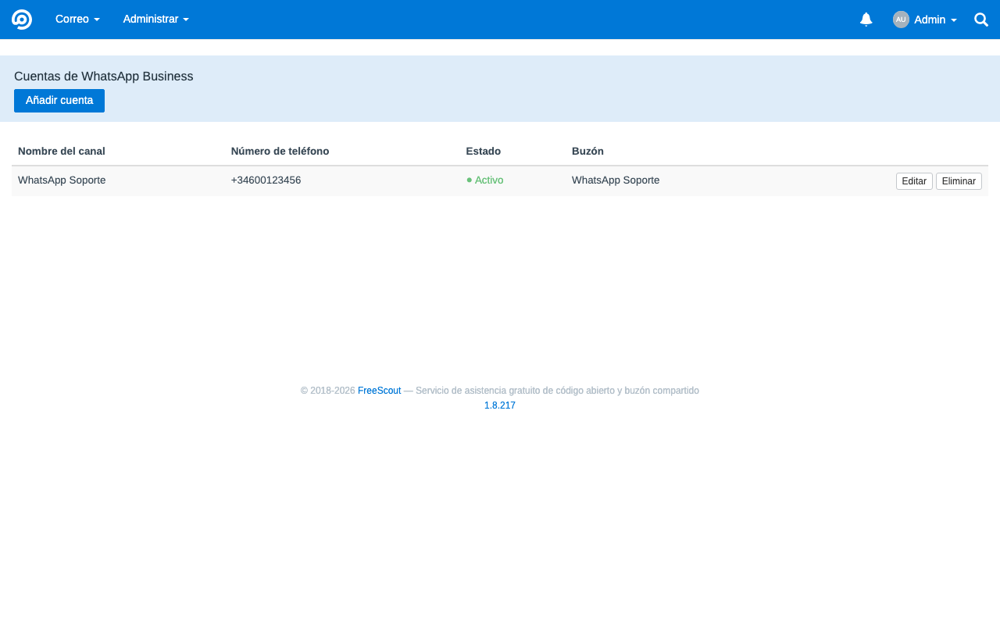
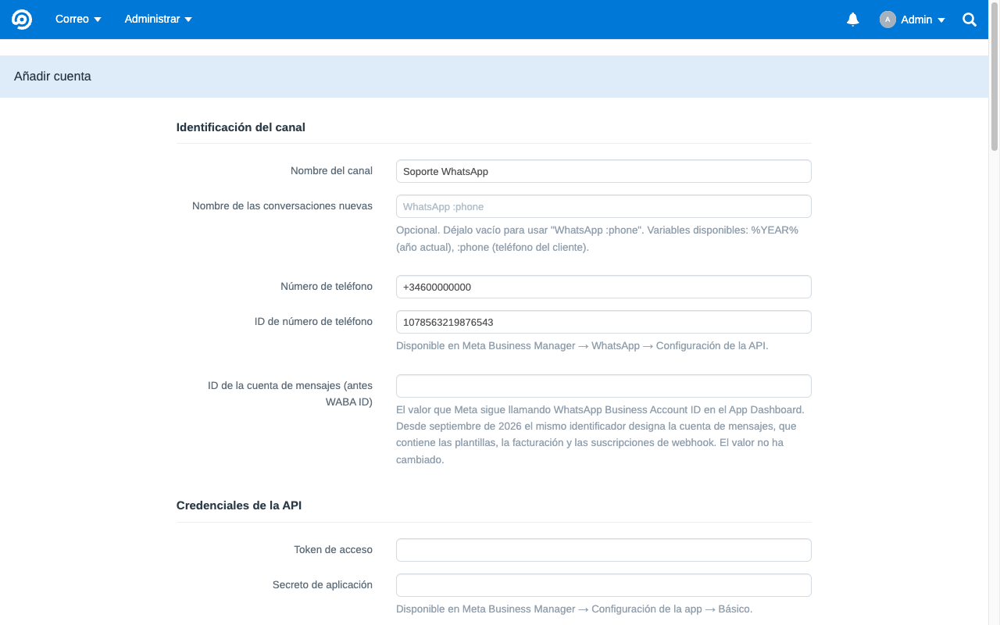
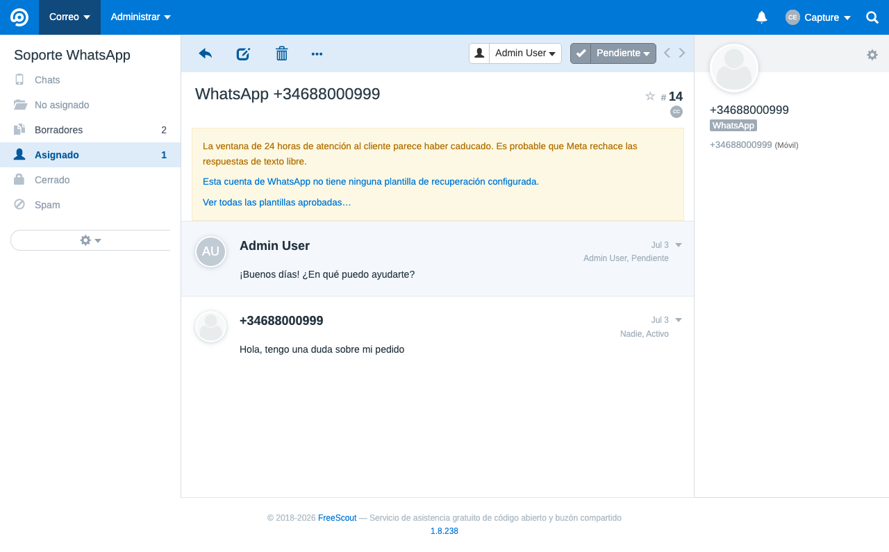
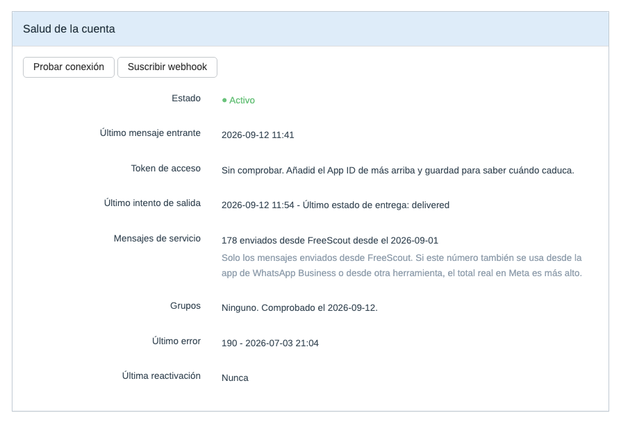
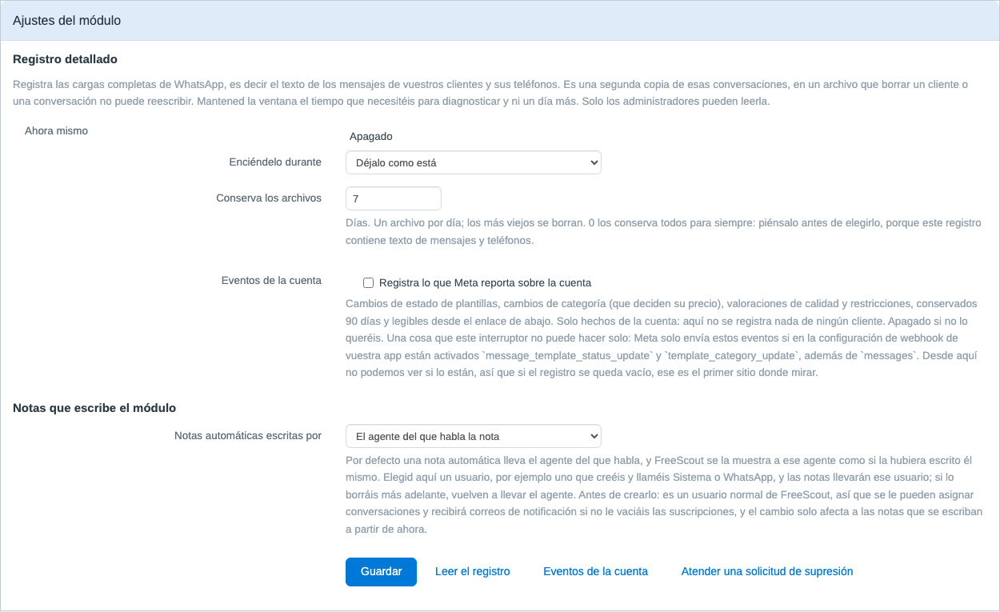
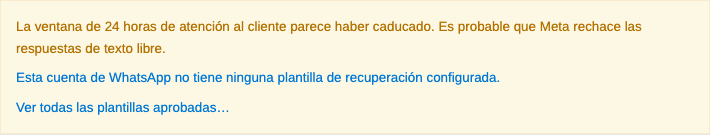
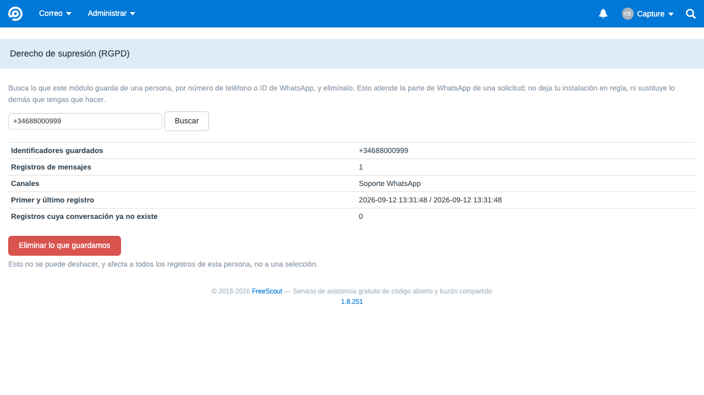

# MetaWhatsApp — WhatsApp Business para FreeScout vía Meta Cloud API

[Català](README.ca.md) · [English](README.md) · [Castellano](README.es.md) · [Nederlands](README.nl.md)

> [!NOTE]
> **Comprobad que vuestra cuenta de WhatsApp Business tenga un método de pago dado de alta.** Fuentes del sector afirman que las cuentas que no lo tengan dejan de tener sus mensajes de servicio entregados, en lugar de recibir la factura después. No aparece en ninguna página de Meta, este módulo no lo puede comprobar por vosotros, y el fallo es silencioso: los clientes siguen escribiendo y las respuestas dejan de llegar. Ver [Qué cobra Meta](#qué-cobra-meta).

<!-- Revisar cuando Meta publique la franquicia, o deje de contradecirse entre
     la página de tarifas y el changelog. En noviembre de 2026 el changelog
     sigue diciendo que las conversaciones de servicio son gratis desde
     noviembre de 2024. -->

Módulo para FreeScout que integra **WhatsApp Business directamente con la Meta Cloud API**, sin intermediarios de pago como 1msg.io o Twilio. Los mensajes van de Meta a tu instalación de FreeScout, con control completo de credenciales, datos y flujo operativo.

El proyecto es público y lleva en uso real de producción desde la v1.0, iterando a partir de incidencias reportadas por usuarios en lugar de un roadmap fijado: plantillas, multimedia, stickers, contactos, mensajes de ubicación y reacción, monitorización del estado de conexión y reactivación guiada de cuentas se han añadido en respuesta al uso real del día a día, no planificados de antemano. Es estable, pero sigue evolucionando activamente — ver [Limitaciones conocidas](#limitaciones-conocidas) más abajo para los huecos detectados así que aún no están resueltos.

## Características principales

- **Channel-first**: configuras un canal de WhatsApp, no un buzón de correo.
- **Zero-core**: no modifica ningún fichero del core de FreeScout.
- **Fail-closed**: el webhook rechaza cualquier petición sin firma HMAC válida.
- **Integración directa con Meta**: sin pasarelas de terceros.
- **Interfaz limpia de correo**: en las vistas del canal, el módulo oculta los artefactos de email del core (toggle Cc/Bcc, dirección técnica interna) sin afectar a los buzones de correo normales.
- **Compatible con FreeScout 1.8.x**, que corre sobre Laravel 5.5 y PHP 7.1 o superior.

## Inicio rápido

Cinco pasos desde una instalación de FreeScout nueva hasta tener un canal de WhatsApp funcionando. Cada paso enlaza con el detalle completo más abajo — es el camino más corto, no un sustituto.

1. **Instala el módulo.** Activa **MetaWhatsApp** desde Manage → Modules (o los tres comandos `artisan` si trabajas desde la línea de comandos). Ver [Instalación](#instalación).
2. **Prepara Meta.** Necesitas una App de tipo Business con el producto WhatsApp añadido, un número de teléfono registrado, y cuatro valores del App Dashboard: **Phone Number ID**, **ID de la cuenta de mensajes** (el campo que Meta sigue llamando **WABA ID**), **Access Token**, **App Secret**. Ver [Requisitos previos en Meta](#requisitos-previos-en-meta) — en particular, genera un token permanente en lugar del de 24 horas que Meta muestra por defecto.
3. **Añade el canal en FreeScout.** Manage → WhatsApp → Add account, pega los cuatro valores, guarda. Ver [Configuración del canal → En FreeScout](#en-freescout).
4. **Apunta Meta hacia el webhook.** Pega la URL del webhook y el verify token que la página de la cuenta te acaba de dar en la pantalla de configuración de Webhook de Meta, y activa el campo `messages`. Si además quieres que se llene el panel de eventos de la cuenta, activa ahí también `message_template_status_update`, `template_category_update`, `account_update`, `account_alerts`, `phone_number_quality_update` y `account_review_update`: sin ellos Meta no envía nada y ese panel se queda vacío por mucho que lo activéis en FreeScout. Ver [Configuración del canal → En Meta](#en-meta).
5. **Envía un mensaje real** al número y confirma que crea una conversación en FreeScout, luego responde desde FreeScout y confirma que llega al teléfono.

Si el paso 5 no funciona, empieza por [Resolución de problemas](#resolución-de-problemas) y [Cuando no es cosa del módulo](#cuando-no-es-cosa-del-módulo) antes de asumir que el problema es del módulo — un worker de colas detenido, una URL de webhook que no coincide del todo, o un problema de certificado explican la mayoría de incidencias del primer día.

## Capturas de pantalla

*Listado de canales de WhatsApp configurados:*



*Alta de un canal nuevo (formulario channel-first):*



*Una conversación de WhatsApp tal como la ve un agente, con el distintivo de canal que pinta el propio FreeScout:*



*Salud de la cuenta, con los botones de prueba de conexión y suscripción del webhook:*



*Ajustes del módulo: el registro detallado que se enciende durante una ventana y se conserva unos días, y de quién vienen las notas automáticas:*



*Aviso en la conversación cuando la ventana de 24 horas del cliente parece caducada:*



*Atendiendo una solicitud de derecho de supresión: lo que el módulo guarda de una persona, antes de decidir eliminarlo:*



## Alcance de funcionalidades

Actualmente cubre:

- Mensajes de **texto plano** entrantes y salientes.
- Uno o más números de WhatsApp, cada uno como cuenta independiente del módulo.
- Creación automática de conversaciones en FreeScout a partir de mensajes entrantes.
- Respuesta desde FreeScout hacia WhatsApp respetando la ventana de deshacer del core.
- Actualización best-effort de los estados `delivered` y `read` en la base de datos del módulo; desde la v1.2.0, un `read` de Meta también marca el thread outbound como abierto, con el indicador nativo "abierto" de FreeScout. Desde la v2.1.0, un estado `played` (una nota de voz que el cliente ha escuchado) recibe el mismo tratamiento.
- Desde la v1.3.0, recuperación manual de una ventana caducada con una plantilla HSM preaprobada — ver [Recuperación de ventana caducada](#recuperación-de-ventana-caducada-v130) más abajo.
- Desde la v1.4.0, mensajes multimedia (imagen, vídeo, audio, documento): descarga y adjunción entrante, previsualización en miniatura de imágenes, envío saliente limitado a la ventana abierta de 24h — ver [Soporte multimedia](#soporte-multimedia-v140) más abajo.
- Desde la v1.5.0, mensajes entrantes de ubicación y reacción (incluyendo contexto del mensaje citado), y un panel de estado de conexión por cuenta (último inbound/outbound, último error, botón "Test connection").
- Desde la v1.5.1, los IDs de canal oficiales de Meta (`103`/`104`).
- Desde la v1.6.0: hasta 5 plantillas de recuperación configuradas estáticamente por cuenta (además del flujo de una sola plantilla de la v1.3.0), o cualquier plantilla aprobada por Meta obtenida en vivo mediante un selector dinámico; stickers y tarjetas de contacto entrantes; visibilidad de fallos de entrega asíncronos (se añade una nota si Meta informa de que un mensaje ha fallado tras haber sido aceptado inicialmente); registro automático del webhook desde el formulario de la cuenta (sin paso manual en Meta Business Manager).
- Desde la v1.6.1, reactivación guiada de una cuenta inactiva directamente desde "Test connection", con trazabilidad (quién/cuándo) en el panel de estado.
- Desde la v1.7.0: el formato de texto entrante de WhatsApp se renderiza en lugar de mostrarse literal; las conversaciones llevan el canal informado, de modo que aparecen la etiqueta de WhatsApp y el botón de Chat Mode propios de FreeScout; el último mensaje del cliente se marca como leído cuando un agente responde; y un fallo de entrega reabre la conversación citando un extracto del mensaje que no ha llegado.
- Una pantalla de administrador para atender una solicitud de derecho de supresión: buscar lo que el módulo guarda de una persona por el número de teléfono o por el ID de WhatsApp, eliminarlo, y llevarse un comprobante de un solo uso que también indica qué queda fuera del alcance del módulo.

Queda fuera de alcance:

- Transformación o redimensionado de imagen/vídeo, vistas de galería o carrusel.
- Un adaptador de almacenamiento en la nube (S3, etc.) para multimedia — los adjuntos usan el almacenamiento local ya existente de FreeScout.
- Indicadores visuales de `delivered/read` en la conversación (el `read` solo abre el thread — ver arriba).
- Chatbots, automatizaciones avanzadas o integraciones multicanal compartidas.
- Vincular un número por el protocolo no oficial de dispositivo acompañante de WhatsApp Web, como hacen algunos clientes de escritorio. No necesita aprobación de la Cloud API, que es justo lo que lo hace tentador, y queda fuera de alcance a propósito: el protocolo está hecho por ingeniería inversa, Meta puede romperlo cuando quiera, y usarlo puede acabar con el número suspendido. En una cuenta personal esa es la apuesta de quien la asume. En la línea de atención de una empresa, una suspensión detiene todas las conversaciones a la vez, así que el módulo no va a correr ese riesgo en su nombre.

## Novedades en la v3.1.0

- **Las notas automáticas del módulo ahora avisan a los agentes que lo habían pedido** (#64). Una respuesta rechazada, un mensaje que Meta dice que no se ha entregado, un envío que falla: la nota aparecía en la conversación y no avisaba a nadie, ni siquiera a un agente suscrito a las notas. También se avisa al agente cuya respuesta ha fallado, que es el aviso que más importa aquí. Reportado con todo el mecanismo por [@MarkoD](https://github.com/MarkoD).
- **Las reglas de Workflow que reaccionan cuando se añade una nota empezarán a coincidir con las notas del módulo.** Ahora disparamos la acción `conversation.note_added` del core, igual que una nota escrita a mano, así que los demás módulos ven las nuestras como cualquier otra. Si tenéis una regla con ese disparador, revisadla antes de actualizar.
- **Quién firma una nota automática cambia en las instalaciones que no han elegido a nadie** (#68). Antes era el agente del que habla la nota, y FreeScout muestra una nota a su autor como si la hubiera escrito él, así que el agente leía la frase del módulo como suya. Ahora es el primer administrador de la instalación. El usuario que elijáis en esa opción es también el único que no recibe aviso de estas notas, así que un usuario de marcador llamado Sistema o WhatsApp es la elección correcta, y alguien que trabaja conversaciones no.
- **El registro de eventos de la cuenta conserva lo que promete su interruptor** (#66): restricciones, infracciones, bloqueos y rehabilitaciones de la cuenta, salida forzada, avisos sobre límites de envío, sobre el estado de cuenta de empresa oficial y sobre una foto de perfil borrada, cambios de caudal por número y la decisión de la revisión de políticas. El texto ya no promete la valoración de calidad de los mensajes, porque Meta no envía ningún webhook con ese valor; ahora dice dónde se puede leer.
- **Un fallo que Meta reporta de un mensaje que el módulo no puede emparejar ahora se escribe donde se puede ver** (#65). Acababa en una línea de depuración, y el nivel de registro por defecto de FreeScout no escribe depuración, así que un mensaje fallaba y en ningún sitio se decía nada.
- **Una respuesta rechazada con el canal apagado ya no se pierde por un camino y se conserva por el otro.** Rechazada antes de encolarse, esperaba y salía cuando el canal volvía. Rechazada unos segundos más tarde dentro del job, no se volvía a enviar nunca, y el cliente no recibía ninguna respuesta.
- **Un acuse de lectura ya no marca un mensaje que el cliente ya había visto contestado**, y en una conversación con dos números de un mismo cliente la respuesta va a la persona que el agente está leyendo. Tres sitios decidían cada uno cuál era el último mensaje entrante, y Meta los entrega desordenados hasta siete días.
- **El interruptor de copia por correo dice cuándo la instalación tiene esa función apagada para todos** (#57), en lugar de parecer una opción que hace algo.
- **Un mensaje que llega a la cola con días de retraso ya no abre una ventana que no existe.** Meta no entrega nunca ninguno tan viejo, pero un job reintentado tras un retraso sí, y su marca de tiempo real se tiraba, así que el reloj lo leía como recién llegado: el agente tenía la casilla de respuesta libre en una conversación que Meta tenía cerrada, y la respuesta volvía rechazada. Ahora solo se rechaza una hora que ningún mensaje de WhatsApp puede llevar, porque creerse una marca vieja solo puede cerrar la ventana, que es la verdad.
- **El borrado quita el número también del nombre del registro del cliente**, que es la copia más visible de todas, y la pantalla ahora dice cuántos de los registros que está a punto de cambiar llevan también otros datos, por ejemplo un contacto importado que resulta que lleva ese número. De esos registros solo se quita la identidad borrada.
- **La tarjeta del módulo tiene icono** (#63): un auricular blanco sobre el azul de FreeScout. Azul y no el verde de WhatsApp, y un auricular solo y no dentro de un bocadillo, porque esa forma es marca de Meta y el azul dice que esto es un módulo de FreeScout y no un producto de WhatsApp. Pedido por [@MarkoD](https://github.com/MarkoD).
- Los README y la pantalla de configuración ahora dicen de quién es la marca y que este proyecto no está afiliado a ella.

## Novedades en la v3.0.0

- **Identificadores que dejan de ser legibles.** Los ids de mensaje de Meta llevan el número de teléfono dentro; ahora una supresión lo sustituye por una huella de un solo sentido, y una migración hace lo mismo con las filas que ya habían borrado versiones anteriores. Por eso se mueve el primer dígito: el significado de datos almacenados ha cambiado. (La pantalla de supresión salió en la v2.2.0.)
- **La pantalla de supresión alcanza dos cosas que se le escapaban**: los enlaces de contacto que quedan cuando se borra un canal o su buzón, de los que respondía que no había nada, y el número en la lista de teléfonos y en los campos de canal de la ficha del cliente.
- **La ventana de 24 horas se cuenta desde la hora que Meta registra**, y no desde el momento en que el trabajador de la cola escribió la fila. Cada retraso entre ambas hacía parecer la ventana más abierta de lo que estaba.
- **Ocho caminos que rechazaban enviar una respuesta no dejaban nada en la conversación.** Todos dejan ahora una nota que el agente puede ver, incluida una respuesta que muere porque el canal está apagado, que antes no dejaba rastro en ningún sitio.
- **El texto del agente ya no se pierde con el adjunto que lo llevaba**, y un archivo de un subtipo que WhatsApp no acepta se envía como documento, así que llega en lugar de ser rechazado como la imagen o el audio que se iba a enviar.
- **Un mensaje de WhatsApp de un número que FreeScout ya conoce se archiva bajo ese cliente** en lugar de crear uno segundo, y cuando Meta avisa de que un contacto ha cambiado de número el módulo lo sigue: una respuesta no va a un número que su propietario ha dejado, y un número que la operadora reasigne más tarde no aterriza en la ficha del propietario anterior.
- **Borrar un canal ya no detiene la entrada de los otros números de la misma cuenta de Meta.** La llamada que quita la suscripción del webhook es de toda la cuenta, así que con dos números bajo una WABA se llevaba el otro en silencio.
- **Un mensaje de un tipo que el módulo no puede dibujar llega ahora a la conversación** en lugar de caer en el log, y cuenta para la ventana como cualquier otro.
- **Un interruptor de copia por correo por canal**, desactivado por defecto, para la casilla que FreeScout 1.8.251 añadió y que enviaba la misma respuesta dos veces.
- Un cliente que crea el módulo se nombra ahora con su número de teléfono, o con su identificador de ámbito de negocio, y nunca con el nombre de perfil de Meta.

La mayor parte de esta versión sale de 41 tickets que abrió [@MarkoD](https://github.com/MarkoD) después de leer el código. La lista completa está en el [CHANGELOG](CHANGELOG.md).

## Novedades en la v2.4.0

- **El nombre del buzón en la barra lateral ahora lleva debajo el número de teléfono del canal**, donde un buzón de WhatsApp no mostraba nada (#45). El módulo ocultaba la dirección técnica con CSS, y eso encogía la cabecera 27px, lo que dejaba medio tapado el icono del módulo oficial Mailbox Icons al pasar el ratón. Reportado con capturas de antes y después por [@MarkoD](https://github.com/MarkoD).
- **Corrección**: las notas automáticas llevaban el nombre equivocado a la derecha, el mismo en todas sin importar de quién fuera el mensaje fallido (#43). Esa columna es el asignado de la conversación reflejado en el hilo, que es lo que escribe ahí el propio FreeScout.
- **Corrección**: la sección de instalación decía que el módulo crea dos tablas y listaba dos. Crea tres (#47).
- **El inicio rápido y la página de ajustes ahora dicen qué campos de webhook necesita Meta** antes de que el panel de eventos de la cuenta pueda llenarse (#47). Sin `message_template_status_update` y `template_category_update` activados en Meta, ese interruptor no hace nada y antes tampoco lo decía.
- El cambio de precios de octubre está escrito como historia y no como aviso, en su propia sección junto a la ventana de 24 horas. La nota del método de pago se queda arriba, más corta: una cuenta sin él deja de tener los mensajes entregados, y ese fallo es silencioso.
- CONTRIBUTING ahora dice qué significan los números de versión.

Las versiones anteriores están en la [página de releases](https://github.com/losimo/freescout-meta-whatsapp/releases).

## Compatibilidad con FreeScout

| Versión del módulo | FreeScout que espera |
|---|---|
| 1.10.0 y posteriores | 1.8.234 o superior |
| hasta la 1.9.1 | cualquier 1.8.x |

Desde la 1.10.0 el módulo usa la API de estados de conversación que FreeScout añadió en la 1.8.234, para que un estado aportado por otro módulo se entienda en lugar de quedar clasificado como desconocido. En versiones anteriores vuelve al comportamiento de siempre, que allí es exactamente el correcto, porque un núcleo sin esa API tampoco puede tener estados personalizados. No se rompe nada, y la pantalla de configuración del canal os dice qué ha encontrado.

Ir por encima de la 1.8.234 vale la pena por su cuenta: las 1.8.235, 1.8.236 y 1.8.237 cierran problemas de seguridad del propio FreeScout. La propia 1.8.234 es también cuando el sanitizador de HTML de FreeScout empezó a admitir la etiqueta `<code>`; en cualquier versión anterior, el formato monoespaciado que este módulo renderiza para el texto entrante de WhatsApp (ver [Alcance de funcionalidades](#alcance-de-funcionalidades)) lo borra el core en silencio, no el módulo.

## Instalación

Sigue la [guía oficial de instalación de módulos personalizados de FreeScout](https://github.com/freescout-help-desk/freescout/wiki/FreeScout-Modules#3-installing-custom-modules):

1. Descarga el zip del módulo desde la [página de Releases](https://github.com/losimo/freescout-meta-whatsapp/releases) (o copia/enlaza el código fuente) dentro de `Modules/MetaWhatsApp` en la instalación de FreeScout.
2. Ve a **Gestionar → Módulos** en FreeScout y activa **MetaWhatsApp**. FreeScout ejecuta las migraciones del módulo y limpia la caché automáticamente.
3. El módulo aparecerá en **Gestionar → WhatsApp** para usuarios administradores.
4. Comprobad que llega de verdad: abrid `https://vuestro-freescout/meta-whatsapp/webhook` en el navegador. Tenéis que ver una línea de texto plano diciendo que MetaWhatsApp está instalado y que el punto de entrada responde. Es la misma URL que después pegaréis en Meta, y contesta sin estar identificado, así que funciona aunque haya algún problema de sesiones o de permisos.

> Si en el paso 4 os sale una página no encontrada, las rutas del módulo no llegan a FreeScout. Mirad la sección de resolución de problemas antes de configurar nada en Meta.

Si prefieres la línea de comandos (por ejemplo, en un servidor sin acceso a la interfaz del gestor de módulos), los pasos equivalentes son:

```bash
php artisan module:enable MetaWhatsApp
php artisan module:migrate MetaWhatsApp
php artisan freescout:clear-cache
```

El módulo crea tres tablas propias:

- `meta_whatsapp_accounts`
- `meta_whatsapp_messages`
- `meta_whatsapp_account_events`

No hace ningún `ALTER` sobre tablas del core de FreeScout.

## Requisitos previos en Meta

Antes de configurar el canal en FreeScout, prepara un entorno mínimo en [Meta for Developers](https://developers.facebook.com):

1. Una **App** de tipo Business con el producto **WhatsApp** añadido.
2. Un **número de teléfono** registrado en el producto WhatsApp.
3. Los datos siguientes:

| Valor | Dónde encontrarlo |
|---|---|
| **Phone Number ID** | App Dashboard → WhatsApp → API Setup |
| **WABA ID** | App Dashboard → WhatsApp → API Setup |
| **Access Token** | Ver la nota sobre el token permanente |
| **App Secret** | App Dashboard → App Settings → Basic |
| **App ID** (opcional) | La misma pantalla, justo al lado del App Secret. Con él el módulo os puede decir cuándo caduca el token de acceso |

> **Importante sobre el token**
>
> El token que muestra la pantalla de **API Setup** es temporal y suele caducar en 24 horas. Para un entorno real, genera un **token permanente de System User** desde Meta Business Manager, asignándole la App y el WABA, con los permisos:
>
> - `whatsapp_business_messaging`
> - `whatsapp_business_management`

> **Si tienes más de un número, mantenlos en el mismo portfolio de negocio**
>
> Los identificadores de usuario con ámbito de negocio (BSUID) están ligados al portfolio, así que una misma persona que escriba a dos números tuyos recibe **un solo** identificador si ambos números son del mismo WABA, y **un identificador por número** si están en portfolios separados. Con los números repartidos, el módulo no puede reconocer a esa persona como un único cliente y la resolución de contactos que se describe más abajo no se comporta como esperarías. Consulta la [nota de Meta sobre los BSUID](https://developers.facebook.com/documentation/business-messaging/whatsapp/business-scoped-user-ids/#business-scoped-user-id).

## Configuración del canal

### En FreeScout

Desde **Gestionar → WhatsApp → Añadir cuenta**:

1. Introduce el **nombre del canal**.
2. Introduce el **número de teléfono** en formato E.164 (`+34...`).
3. Rellena **Phone Number ID**, **ID de la cuenta de mensajes**, **Access Token** y **App Secret**.

> **Sobre el nombre.** Meta está dividiendo la cuenta de WhatsApp Business en una **WhatsApp account**, que contiene un número de teléfono, y una **cuenta de mensajes**, que contiene las plantillas, la facturación y las suscripciones de webhook. Tu WABA ID de siempre continúa como identificador de la cuenta de mensajes: el valor no cambia, y tampoco cambia nada de lo que el módulo hace con él. Las pantallas de Meta siguen diciendo WABA ID, así que es el nombre que se usa más abajo cuando te indica dónde mirar.
4. Copia el **token de verificación** generado automáticamente.
5. Copia la **URL del webhook** mostrada por el módulo (siempre tiene la forma `https://tu-dominio/meta-whatsapp/webhook`, compartida por todas las cuentas).
6. Elige si quieres:
   - crear un buzón nuevo (recomendado), o
   - asociar uno existente compatible (sin servidores de correo configurados y no vinculado a otra cuenta de WhatsApp; el desplegable solo muestra los válidos).
7. Guarda la cuenta.

### Quitar un canal

Desde **Gestionar → WhatsApp**, eliminar un canal también lo quita del lado de Meta: el módulo pide a Meta que cancele la suscripción del webhook de ese número, y los eventos dejan de llegar. Si Meta lo rechaza, por ejemplo porque el token ha caducado, el canal se elimina igualmente y el módulo te avisa de que quites la suscripción a mano en el App Dashboard.

Dos cosas se van con el canal, y las dos a propósito:

- **Los registros de mensajes del módulo de ese canal.** Contienen el teléfono del contacto y los identificadores de mensaje de Meta, y una vez el canal no está no se puede llegar a ellos desde ninguna pantalla, así que se eliminan en lugar de quedarse. Las conversaciones se quedan en FreeScout, intactas.
- **Todo lo que el módulo añade al buzón.** El buzón vuelve a ser un buzón normal: vuelven los campos Cc y Bcc, bajo el nombre aparece la dirección técnica en lugar del teléfono, vuelve el botón de conversación nueva, y desaparecen la cuenta atrás de la ventana y el botón de plantillas. No hay nada roto; simplemente ya no es un buzón de WhatsApp.

Eliminar el **buzón** entero, desde la configuración de buzones de FreeScout, elimina el canal con él. Una respuesta que ya estuviera en la cola cuando ocurre cualquiera de las dos cosas no se envía, y el agente recibe una nota en la conversación diciéndolo.

### En Meta

Desde **App Dashboard → WhatsApp → Configuration → Webhook**:

1. En **Callback URL**, pega la URL del webhook del módulo.
2. En **Verify Token**, pega el token de verificación generado en FreeScout.
3. Pulsa **Verify and save**.
4. En **Webhook fields**, activa como mínimo el campo **messages**. Para el registro de eventos de la cuenta, activa ahí también `message_template_status_update`, `template_category_update`, `account_update`, `account_alerts`, `phone_number_quality_update` y `account_review_update`; qué reporta cada uno está en la [matriz de capacidades](docs/capability-matrix.md).

> **Requisito importante**
>
> La URL del webhook debe ser pública, accesible por HTTPS y con certificado válido. Meta no acepta certificados autofirmados.

Cuando la configuración es correcta, un mensaje enviado al número de WhatsApp creará una conversación en el buzón asociado.

## Funcionamiento diario

- Los mensajes entrantes crean una conversación nueva o se añaden a la conversación activa del mismo cliente.
- La identidad del cliente se resuelve por su teléfono, tal como se explica más abajo.
- Responder desde FreeScout envía la respuesta a WhatsApp **pasados los 15 segundos** de la ventana de deshacer del core.
- Si el agente deshace la respuesta dentro de ese margen, el mensaje no se envía.
- Las **notas internas nunca se envían** al cliente.

### A quién se atribuye el mensaje

Un mensaje entrante busca a la persona que hay detrás del número en este orden:

1. Un cliente que ya tenga ese número como canal de WhatsApp.
2. Un cliente que ya tenga ese número en su ficha, importado o escrito por un agente. El módulo le añade el canal de WhatsApp y no toca nada más de la ficha.
3. Si no, un cliente nuevo, nombrado con el número de teléfono, o con el identificador de ámbito de negocio cuando Meta no envía número.

El paso 2 compara los dígitos de forma exacta, así que `+34650387943`, `+34 650 38 79 43` y `0034650387943` son el mismo remitente. Un número guardado **sin el prefijo de país no casa, y es deliberado**: `650387943` puede ser ese móvil español o la cola de un número de otro sitio, y colgar una conversación de la persona equivocada es una avería que no se ve. Guarde los números en E.164 (`+34650387943`) si quiere que casen.

FreeScout no exige que los teléfonos sean únicos. Cuando varios clientes tienen el mismo número, la conversación va a la ficha más antigua y una nota interna nombra las demás, para que un agente pueda fusionarlas.

El nombre de perfil de Meta no se usa a propósito. A menudo son iniciales o un apodo, así que parece un nombre real sin serlo, mientras que un cliente que todavía se llama `+34...` se lee de un vistazo como alguien que nadie ha emparejado con ninguna ficha. Un nombre escrito por una persona tampoco se toca nunca: este módulo solo escribe el nombre de un cliente que crea él.

**Si el contacto cambia de número de teléfono**, WhatsApp lo dice y el módulo lo sigue: el enlace y los mensajes de esa persona se mueven al número nuevo, así que su historia se queda en un solo sitio y las respuestas le siguen llegando. Una nota interna se lo dice al agente, sin escribir ninguno de los dos números. Si el número nuevo ya es de otro cliente, no se mueve nada, porque fusionar dos personas no es una decisión que tome un módulo por su cuenta.

**Una persona con dos números de WhatsApp** funciona: los dos números apuntan al mismo cliente y cada uno tiene su conversación. Es lo que evita que una respuesta vaya al número equivocado, porque el destinatario es el último mensaje entrante de la conversación misma. Si un agente responde en una conversación que no tiene ningún mensaje entrante y el cliente tiene varios números, el módulo no adivina: se abstiene y lo dice en la conversación.

### Ventana de 24 horas

La Meta Cloud API solo permite enviar mensajes libres dentro de las 24 horas posteriores al último mensaje del cliente.

Si se intenta responder fuera de ventana:

- Meta devuelve el error `131047`.
- El mensaje queda registrado como fallido.
- El cliente no recibe ninguna respuesta.

Desde la v1.3.0, una ventana caducada se puede recuperar manualmente con una plantilla HSM preaprobada — ver más abajo.

La cuenta atrás va con la hora que **Meta** registra del mensaje del cliente, no con la hora en que llegó a FreeScout. Las dos se separan siempre que hay un retraso: la cola parada, un job reintentando, o Meta reentregando después de que su endpoint haya estado inalcanzable. Contar desde la llegada mostraba una ventana más abierta que la real, que es la dirección peligrosa: la cuenta atrás parecía sana y la respuesta volvía con un `131047` sin que el cliente recibiera nada.

### Qué cobra Meta

Desde el 1 de octubre de 2026 Meta factura los mensajes de servicio, es decir, cada respuesta de texto libre enviada dentro de esa ventana de 24 horas. Las plantillas de utilidad enviadas dentro de la ventana también vuelven a facturarse, tras quince meses siendo gratuitas. Lo dice Meta en [su página de precios para mensajes que no son plantilla](https://developers.facebook.com/documentation/business-messaging/whatsapp/pricing/non-template-messages): "Effective October 1, 2026, Meta will charge for service messages, which have not been charged since November 2024."

Lo que Meta sigue sin publicar en ninguna parte es la franquicia. La cifra de **1.000 mensajes de servicio por número de teléfono y mes**, que se reinicia cada mes y no se acumula, la dan coincidiendo las fuentes del sector, y os la trasladamos exactamente como eso y nada más.

Dos páginas de Meta siguen contradiciéndose. La enlazada arriba lleva la fecha; la [página de tarifas](https://whatsappbusiness.com/products/platform-pricing/#rates) continúa diciendo que las conversaciones de servicio son gratis, y las plantillas de utilidad dentro de la ventana también. Usad la primera para saber qué cambió y la segunda para las tarifas de vuestro mercado y vuestra moneda, donde cada categoría tiene un precio distinto.

Nada de esto es un cambio del módulo. El módulo no cobra nada ni recibe ninguna comisión, y sus guardas de idempotencia evitan que un reintento de la cola vuelva a enviar un mensaje que ya había salido.

### Cuenta atrás de la ventana (v2.0.0)

Cada conversación abierta de este canal muestra cuánto queda de la ventana de 24 horas, contando desde el último mensaje del cliente — tus respuestas nunca la reinician. Cambia a estilo de aviso durante la última hora. Es puramente informativo: siempre refleja la regla real de Meta, nunca el umbral interno de más abajo.

Desde la v2.1.0, el reloj y el banner de recuperación también se actualizan en vivo mientras la conversación permanece abierta: una respuesta del cliente o el cierre de la ventana se reflejan automáticamente, sin tener que recargar la página.

### Recuperación de ventana caducada (v1.3.0)

Cuando la ventana del cliente parece caducada, aparece un banner en la conversación que permite enviar **una única plantilla de WhatsApp preaprobada**, configurada por cuenta (nombre + idioma). El envío es siempre **manual**: un agente pulsa el botón del banner; no hay ningún reintento automático de plantilla.

- Solo se admite **una** plantilla por cuenta; no hay selector de plantillas ni variables/parámetros.
- Que aparezca el banner depende de un **umbral operativo interno configurable** (`template_threshold_minutes`, por defecto **1435 minutos**). Este umbral solo determina cuándo el módulo empieza a tratar la ventana como caducada para su propia UI — no cambia la regla real de las 24 horas de Meta. Consulta la [documentación de Meta](https://developers.facebook.com/documentation/business-messaging/whatsapp/messages/send-messages).
- Antes de enviar la plantilla de verdad, el servidor vuelve a comprobar la ventana y rechaza la petición si el cliente ha vuelto a escribir mientras tanto (ventana reabierta) o si ya se ha enviado una plantilla para la misma conversación en los últimos 60 segundos (protección contra doble clic / doble envío).
- Meta **factura** los mensajes de plantilla igual que cualquier otra plantilla HSM, de forma independiente a este módulo.

### Token inválido o caducado

Si Meta devuelve el error `190`:

- la cuenta pasa a estado **Inactivo**,
- el canal deja de enviar y recibir correctamente,
- y hay que actualizar el token de acceso desde la edición de la cuenta.
- Una respuesta que un agente escriba con el canal inactivo **no se descarta**. La conversación recibe una nota que lo dice, y la respuesta sale cuando alguien vuelva a responder en esa conversación con el canal restablecido, así que volver a escribirla enviaría la misma respuesta dos veces.

### Soporte multimedia (v1.4.0)

Los mensajes entrantes de imagen, vídeo, audio y documento se descargan de la Meta Cloud API y se guardan como adjuntos normales de FreeScout en el thread de la conversación. Las imágenes, además, tienen una previsualización en miniatura; el resto de tipos se muestran como un adjunto descargable estándar (la fila por defecto de FreeScout).

El envío saliente de multimedia sigue la misma regla que el texto: solo se envía **dentro de la ventana abierta de 24h** (ver arriba) — no hay alternativa con plantilla para multimedia. Cuando un agente responde con adjuntos:

- Se envía un mensaje de WhatsApp **por adjunto** (Meta no admite más de un objeto multimedia por mensaje).
- El texto de la respuesta viaja como **caption** del primer adjunto, salvo que este sea **audio** (Meta no admite caption en audio) — en ese caso el texto se envía como mensaje de texto aparte.
- Cada adjunto se valida de tamaño contra los límites propios de Meta antes de subirlo: **5 MB** para imágenes, **16 MB** para vídeo/audio, **100 MB** para documentos. Los adjuntos demasiado grandes no se envían y se registran como fallidos.

El multimedia se almacena con el almacenamiento local ya existente de FreeScout — no se introduce ningún adaptador de almacenamiento nuevo.

### Enviar la respuesta también por correo

FreeScout muestra una casilla, **Enviar también la respuesta al cliente por correo**, en las respuestas escritas en una conversación de chat fuera del modo chat, y llega ya marcada. En un buzón de WhatsApp eso significa que la misma respuesta puede salir dos veces, una por WhatsApp y otra por correo, sin que el agente lo haya elegido.

El módulo lo detiene por defecto y oculta la casilla. Si quieres esa opción en un canal, activa **Copia por correo** en su configuración: el módulo se aparta y la casilla funciona como FreeScout quiere. Sigue viniendo marcada por defecto cuando aparece, así que conviene avisar a los agentes antes de activarlo.

Hay dos condiciones. El interruptor solo tiene efecto a partir de FreeScout 1.8.251, y que la copia llegue realmente depende de la configuración de salida de tu instalación y no de nada que haga este módulo. Y una trampa que conviene saber antes de empezar, señalada por [@MarkoD](https://github.com/MarkoD): el formulario del canal solo ofrece buzones sin conexión de correo configurada, así que si quieres asociar WhatsApp a un buzón desde el que también quieras enviar correo, **asócialo primero y configura la conexión después**, o no lo encontrarás en la lista.

El core está añadiendo sus propios controles para la misma casilla. `APP_CHAT_CONVERSATION_REPLY_BY_EMAIL=false` en el `.env` la quita de todas partes, y el resto de la condición es que la conversación no esté en modo Chat, que el cliente tenga dirección de correo y que el buzón tenga la salida activa. Una versión anterior de esta línea decía que la salida activa significaba tener una conexión de correo configurada; no lo significa, y aquí la diferencia importa: el método de salida por defecto de FreeScout es PHP mail, que cuenta como activo sin configurar nada, así que en un buzón de WhatsApp la casilla sí aparece. El interruptor de este módulo es lo que la quita. El cambio está en la rama master de FreeScout a fecha del 25 de noviembre de 2026, posterior a la 1.8.252, así que llegará en la versión siguiente. Si has desactivado ese parámetro, la configuración del canal ahora lo dice junto a **Copia por correo**, porque con la puerta del core cerrada activar el interruptor no haría nada. Lo mismo se dice cuando el buzón no tiene ningún método de salida activo, que esa puerta también rechaza.

## Datos personales

[Qué guarda este módulo de vuestros clientes, dónde lo guarda, y qué se borra cuando eliminéis un cliente o una conversación](docs/personal-data.md). También dice claramente los huecos que tiene, incluidos los tres sitios donde el borrado no llega: el archivo de registro detallado, la cola de trabajos del core, y las dos columnas de canal que FreeScout escribe en un cliente y nunca limpia. El documento está en inglés.

## Limitaciones conocidas

Estas limitaciones son conocidas y aceptadas dentro del alcance actual de funcionalidades:

- Los tipos de mensaje distintos de texto, multimedia (incl. stickers), botón, ubicación, reacción y contactos (p. ej. `order`, respuestas de lista `interactive`, o cualquier cosa que Meta entregue como `unsupported`) no se pueden representar. Desde la v3.0.0 ya no se descartan: el mensaje llega a la conversación como una entrada **Mensaje no compatible**, con el tipo cuando Meta lo nombra, y cuenta para la ventana de 24 horas como cualquier otro. Aparece donde iría el mensaje del cliente, porque es lo que es, así que también reabre una conversación cerrada y avisa al agente asignado. Lo que envió realmente solo se ve en WhatsApp. Los avisos *sobre* un mensaje (borrarlo, editarlo, fijarlo) no se muestran ni reabren nada.
- Un cliente que escribe con un **nombre de usuario** de WhatsApp y sin teléfono disponible queda archivado correctamente, pero **no se le puede responder**: este módulo envía solo por número de teléfono. La respuesta se rechaza con una nota visible en la conversación. Meta documenta el envío a un identificador de ámbito de negocio; este módulo todavía no lo implementa.
- La descarga de multimedia entrante no tiene validación de tamaño propia del módulo más allá de la que Meta ya aplica antes de entregar el webhook.
- No hay vista de galería o carrusel para imágenes/vídeos — cada adjunto aparece como una fila/miniatura independiente, igual que cualquier otro adjunto de FreeScout.
- Hasta 5 plantillas configuradas estáticamente por cuenta, o cualquier plantilla APPROVED obtenida en vivo mediante el selector dinámico (con variables `{{n}}`); sin sincronización/caché automática de la lista estática desde el catálogo de Meta.
- El envío de la plantilla de recuperación es siempre **manual**, iniciado por un agente desde el banner de la conversación; no hay reintento automático fuera de ventana.
- Los estados `delivered` y `read` se actualizan en la base de datos del módulo; solo el `read` se muestra visualmente (vía el indicador nativo "abierto" del thread) — el `delivered` no se muestra en la conversación.
- Si Meta agrupa varios eventos en un solo envío de webhook, cada uno se encamina según lo que realmente es: un mensaje se atribuye por su propio número de teléfono y se descarta si nombra uno distinto, mientras que un hecho de nivel de cuenta llega a todos los canales activos de la WABA a la que pertenece, y se descarta si nombra otra WABA. Un hecho de un solo número de teléfono de la empresa, como un cambio de caudal o una alerta que nombra ese número, va al canal que es su propietario, también si lo tenéis apagado, porque de quién es un número es una pregunta de identidad. En la práctica Meta suele enviar webhooks separados por número, pero conviene tenerlo presente con varios números bajo la misma App.
- En modo chat, el core de FreeScout puede generar **borradores vacíos** en la conversación por el autoguardado del editor; son inocuos y se pueden descartar manualmente.
- El **buzón técnico** del canal sigue siendo visible en **Gestionar → Buzones**.
- El webhook no implementa rate limiting propio; la barrera principal es la firma HMAC.
- El lookup del `verify_token` en el handshake no es constant-time.

## Checklist para pasar a cuenta real

Antes de pasar de pruebas a producción:

1. ☐ Comprueba que la instalación es accesible públicamente por HTTPS.
2. ☐ Usa un certificado válido.
3. ☐ Genera un **token permanente de System User**.
4. ☐ Elimina cuentas y conversaciones de prueba si ya no las necesitas.
5. ☐ Crea la cuenta real en el módulo con las credenciales definitivas.
6. ☐ Configura el webhook real en Meta con la URL y el verify token correctos.
7. ☐ Verifica que la suscripción al campo `messages` está activa.
8. ☐ Envía un mensaje real al número y comprueba que entra en FreeScout.
9. ☐ Responde desde FreeScout dentro de la ventana de 24 horas y comprueba que llega al móvil.
10. ☐ Verifica que el worker de colas funciona de manera continua.
11. ☐ Revisa los logs después de las primeras pruebas reales.

## Resolución de problemas

| Síntoma | Causa probable |
|---|---|
| Meta no verifica el webhook | URL no accesible públicamente, certificado inválido o verify token incorrecto |
| Meta recibe 403 en los POST del webhook | `phone_number_id` o WABA desconocido, cuenta inactiva o firma HMAC inválida |
| Los mensajes entran pero no salen | Error `131047` por ventana de 24 horas o error `190` por token caducado |
| La cuenta aparece como `⚠ Buzón desvinculado` | Falta la fila del buzón. Eliminar un buzón ya no deja este estado, porque el canal se va con él, así que solo se verá tras una restauración o un cambio hecho directamente en la base de datos |
| No se procesa nada | El worker de colas está parado (`php artisan queue:work`) |
| **Gestionar → WhatsApp** da "página no encontrada" | Las rutas del módulo no llegan a FreeScout. Abrid `/meta-whatsapp/webhook`: si responde, las rutas están vivas y el problema es otro; si también da 404, no llegan. Tened presente que `/meta-whatsapp` es una ruta y no una carpeta, así que no hay nada que buscar en el disco, y que un 404 no se escribe nunca en ningún registro, por lo que un registro vacío no significa nada |
| Un fix de una actualización del módulo no parece aplicarse | El worker de colas sigue ejecutando código antiguo en memoria. Reiniciar el cron no lo recarga; hace falta `php artisan queue:restart` |
| Las páginas dan 500, o el reloj de ventana nunca se actualiza tras una actualización del módulo | Un symlink de los assets del módulo roto. Abre **Gestionar → Módulos** una vez; FreeScout lo repara automáticamente |

Todos los logs del módulo llevan el prefijo `[MetaWhatsApp]`.

```bash
grep MetaWhatsApp storage/logs/laravel-$(date +%Y-%m-%d).log
```

## Cuando no es cosa del módulo

Parte de lo que impide que este módulo funcione no está en el módulo: un cron que no se ejecuta nunca, un controlador de colas que cambia en silencio qué significa "enviado", un directorio donde el servidor web no puede escribir. La pantalla de configuración ahora las comprueba y nombra las que encuentra, en rojo cuando la instalación no puede funcionar y en amarillo cuando funciona con un matiz.

Preferimos darle el diagnóstico a dejarle adivinando, y para eso están estas comprobaciones. Lo que el módulo no puede hacer es cambiar su servidor: varias de estas son opciones que solo pueden tocar usted o su proveedor de alojamiento. Si el suyo no puede cambiarlas, vale la pena saberlo igualmente, porque mueve la pregunta de qué está haciendo mal a qué permite el alojamiento.

| Qué ve | Qué comprobar |
|---|---|
| No sale ni entra nada, y no hay ningún error en ninguna parte | El worker de cola. Una respuesta se encola, así que parece enviada en la conversación y no sale nunca. Compruebe que el cron ejecute el planificador de FreeScout cada minuto, y cuántas filas tiene la tabla `jobs` |
| Todo iba bien y de golpe nada, normalmente tras cambiar de servidor | El `APP_KEY` de FreeScout. Las credenciales se cifran con él, o sea que una clave nueva las hace ilegibles. Vuelva a introducir el token y el secreto en la página del canal |
| Meta no verifica el webhook | La URL tiene que ser exactamente la que aparece en la página del canal, en https con certificado público válido, y el dominio tiene que coincidir con `APP_URL` |
| El canal ha enmudecido justo tras activar el registro detallado | `storage/logs` no es escribible, normalmente tras ejecutar comandos artisan como root. Restaure su propietario. El módulo ahora se niega a activar el registro en ese estado en lugar de detener el canal |
| El test de conexión da error 60, o agota el tiempo | El CA bundle o un cortafuegos de salida de su alojamiento, no las credenciales |
| Los adjuntos grandes no llegan nunca y los pequeños sí | El `memory_limit` de PHP. El contenido entrante se guarda en memoria y WhatsApp acepta documentos de hasta 100 MB. El módulo ahora rechaza un archivo demasiado grande y conserva el mensaje, en lugar de perder ambos |

Si quiere que lo miremos, las dos cosas útiles son el texto de cualquier aviso de la pantalla de configuración y las líneas de registro del módulo:

```bash
grep MetaWhatsApp storage/logs/laravel-$(date +%Y-%m-%d).log
```

Quite los teléfonos de los clientes y el texto de los mensajes antes de publicarlas.

## Tests

La suite de tests del módulo se puede ejecutar con:

```bash
vendor/bin/phpunit --no-configuration --bootstrap vendor/autoload.php Modules/MetaWhatsApp/Tests
```

Los tests trabajan contra la base de datos de la instalación con rollback por test y no dejan datos persistentes.

## Licencia

AGPL-3.0, igual que FreeScout.

## Marcas

WhatsApp y Meta son marcas de Meta Platforms, Inc. Este módulo es un proyecto
independiente, no está afiliado a Meta Platforms, Inc. ni cuenta con su
respaldo, y usa esos nombres solo para decir a qué servicio se conecta.

## Créditos

El auricular del icono del módulo es de Font Awesome Free 6.7.2, de
Fonticons, Inc., con licencia [CC BY 4.0](https://creativecommons.org/licenses/by/4.0/).
Lo hemos recoloreado de blanco y puesto sobre un campo azul de FreeScout.
